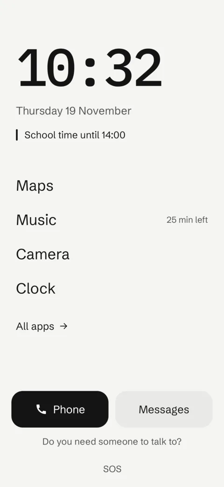
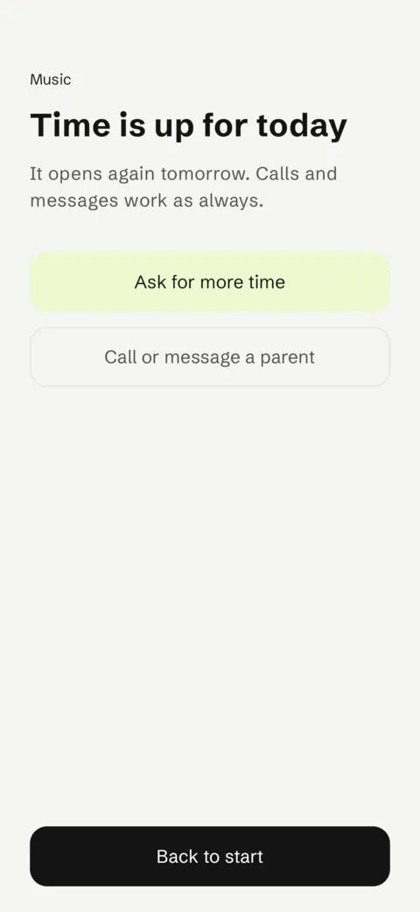
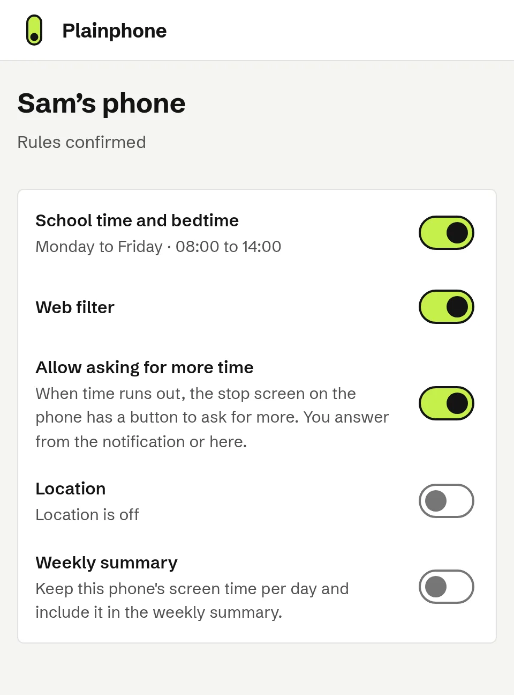

# Plainphone

[](https://github.com/plainphone/plainphone/actions/workflows/ci.yml)
[](LICENSE)

Plainphone turns an ordinary Android phone into a calm phone: calls, messages, maps, music and the apps you actually need, without social media, endless feeds, games and porn.

<p align="center">
  
</p>

It is meant for a parent setting up a child's first phone, and for adults who want to hold themselves to their own rules. The rules work the same way in both cases. What changes is who holds the key.

[English](https://plainphone.org/) · [Dansk](https://plainphone.org/da/) · [Svenska](https://plainphone.org/sv/) · [Norsk bokmål](https://plainphone.org/nb/) · [Deutsch](https://plainphone.org/de/)

[Parent dashboard](https://app.plainphone.org) · [Setup guide](https://plainphone.org/setup/) · [App and website lookup](https://plainphone.org/apps/) · [Self-hosting](docs/self-hosting.md) · [Translations](docs/translations.md) · [Releases](https://github.com/plainphone/plainphone/releases)

Plainphone is free today. Running it on your own server and keeping one fully protected phone on our hosted service will always be free. Later we’ll charge for additional phones on our service. We’ll tell early users well in advance. The groundwork is in the code but switched off, and a paywall never touches locking, release, SOS, 112 or getting a phone back: see [billing](docs/billing.md).

> **Status: public alpha.** Everything below works together in test builds, but it has had little testing on real phones and no external security audit. Try it on a spare phone or an emulator. Do not make it the only phone a child relies on yet. The hosted service at app.plainphone.org is a free test service, provided as is under its [terms](https://plainphone.org/terms/), and it can read the data you put in it (see [Privacy and security](#privacy-and-security)). Its data is kept during the alpha and is never wiped without at least 30 days' notice, by mail to account holders and in [Discussions → Announcements](https://github.com/plainphone/plainphone/discussions/categories/announcements); phones keep their last rules offline ([what happens and how to get out](docs/privacy.md#the-hosted-test-service-during-the-alpha)). Releases from v0.1.10 use the production signing key; v0.1.9 and earlier used a test key.

<p align="center">
  
  
  
</p>

## Try it

**On a spare phone, without a factory reset (light mode, about 5 minutes):**

1. Sign in at [app.plainphone.org](https://app.plainphone.org) with your email address. The sign-in link arrives by mail.
2. Choose **Add phone → It is already in use**, pick **Child** and create a setup link. Child is the quickest profile to try and to leave again.
3. Open the link in Chrome on the spare phone, install the APK and follow the steps. [Light mode](docs/light-mode.md#installing-it-no-reset) explains each one.
4. Getting out: **Undo setup** works without a PIN for the first ten minutes, and a reboot closes that window. After that, use **Release the phone** in the dashboard (it takes effect at once for a Child phone) or the maintenance PIN on the phone, then uninstall Plainphone.

Trying **Myself** instead? Releasing a Myself phone loosens it, so it waits for the key you picked during setup: 1 to 72 hours, or a trusted person's approval. Its undo window can be off or as short as 5 minutes. See [Myself setup and trusted keys](docs/self-keys.md) before you start.

**On an emulator:** an Android 10 or newer image with Chrome should work the same way, though CI only runs strong mode on emulators ([emulator tests](docs/testing.md)). You can also install the APK from the [releases](https://github.com/plainphone/plainphone/releases) with `adb install plainphone-VERSION.apk`, open Plainphone so it shows a pairing code, and enter it in the dashboard under **Add phone → I have a code from the phone**.

**Strong mode** needs a phone you can factory reset. Follow [Set up a test phone](docs/setup-test-phone.md), which also covers [getting out again](docs/setup-test-phone.md#5-getting-out-again), then try the [bypass checklist](docs/bypass-checklist.md).

**Check the APK.** All releases are still marked as pre-releases; take the newest. Compare `sha256sum plainphone-VERSION.apk` with the SHA-256 in the release notes (and in the `.apk.json` file, from v0.1.19), and the signer certificate with the digest under [Signing](#signing).

**Tell us how it went.** Bugs and [phone test reports](https://github.com/plainphone/plainphone/issues/new/choose) go in issues. Questions go to [Discussions](https://github.com/plainphone/plainphone/discussions/categories/q-a). A way around the lock is a security bug: report it privately as described in [SECURITY.md](SECURITY.md).

## Why

Plainphone is built on a short list of [design principles](docs/design-principles.md), each tied to research, regulation or official guidance. The [evidence review](docs/evidence.md) lists the sources per feature and says where the evidence is weak. In short:

- the child can see, on the phone, what the parent can see;
- monitoring is visible, never hidden;
- emergency calls and help stay reachable whatever the rules say;
- no streaks, rewards or engagement tricks;
- as little data as possible, kept as briefly as possible.

The [common design tokens](docs/design-tokens.md) keep the colours the same on every surface.

A filter reduces exposure. It does not make a phone safe, and Plainphone does not claim to.

## How it works

One Android app, two ways to install it. The phone follows the rules set in the parent dashboard (the [web app](web) or the [native app](parent-app)). Offline, the last rules keep applying, and an error never loosens anything.

### Strong mode: a new or reset phone

The app is set up by QR code on a factory-reset phone (Android 10 or newer, see [docs/android-versions.md](docs/android-versions.md)) and becomes **Device Owner**. It then:

- blocks app installs (Play Store and APK files), factory reset from Settings, safe mode, new users, guest mode, private space, app cloning, developer options and adb;
- forces private DNS (DNS-over-TLS) to a filtering resolver and stops the user from changing private DNS, VPN, network reset and user certificates;
- turns Chrome's own DNS-over-HTTPS and incognito mode off and forces SafeSearch;
- hides every app that is not on the allowlist: phone, messages, camera, clock, contacts, settings, keyboard and launcher (found per device, so Samsung and Xiaomi keep their own apps), plus Chrome, Maps, calculator, calendar and gallery;
- lets parents lock or unlock the Android system language on strong-mode Child phones;
- requires automatic date and time, blocks USB file transfer and SD cards, and blocks uninstalling Plainphone;
- optionally sets a Factory Reset Protection policy for chosen Google accounts.

A hidden maintenance screen protected by a parent PIN can lift the lock for a while, re-apply it, or release Device Owner completely, so a test phone never has to be thrown away. A parent can also release a phone from the dashboard (**Release the phone**): the phone switches Plainphone off by itself the next time it is online. The dashboard shows the release as pending until the phone confirms it has switched off. If confirmation is delayed, check the last phone report and verify the phone’s state before considering a reset.

Adding a Play account during an approved app install needs the parent PIN. Plainphone requests Google sign-in directly while Android keeps user account changes blocked. If sign-in fails, the parent can retry with account changes allowed briefly within the same [installation window](docs/app-catalog.md). The retry option expires when that window ends. Once tapped, it allows account changes for at most three minutes, and the dashboard shows them as allowed until that deadline. The dashboard warns about any Google account the parents did not approve, also one that appears long after the window. On Android 10, Force stop is unavailable while such a window is open. Reset protection and hardware system checks are described in [docs/policies.md](docs/policies.md).

[docs/policies.md](docs/policies.md) lists every policy, what Android does not let us block, and links to the Android documentation.

**Protection after a reset.** Link a parent’s Google account in the dashboard. Wait until the account is ready and the phone reports that it has saved the protection settings before resetting the phone. See [docs/policies.md](docs/policies.md#factory-reset-protection).

### Light mode: a phone already in use

The same APK, installed as a normal app, without a reset. A local VPN that only carries DNS provides the default web filter, and an accessibility service keeps apps that are not allowed from opening. It is weaker than strong mode, and the dashboard says exactly how. The guard checks protected Settings windows when they open or regain focus. It verifies the active window before sending Back. It retries if Android rejects that action. On first launch, choose **Child**, **Parent**, or **Myself**. Parent opens the dashboard without
requesting permissions. Child and Myself confirm the phone and check the dashboard account
before Android asks for permissions. Light-mode setup can be undone without a PIN for ten
minutes by default after finishing permissions. The dashboard shows the reported deadline. Rebooting closes the window. Undo switches off protection
even offline. The phone reports Undo when it reconnects, even before its first rules sync.
The server removes the phone and notifies current household members whenever the report arrives.
If a self-hosted server lacks the undo endpoint, the phone keeps retrying until it gets confirmation.
School time, bedtime, modes and limits run on the server's time, so setting the phone's clock by hand
moves nothing; after a restart without a sync, a window that may be on counts as on. See
[docs/light-mode.md](docs/light-mode.md) and [the phone's clock](docs/light-mode.md#the-phones-clock).

### Open mode: every app except what you block

On a Myself phone, open mode allows every app, also new ones, except a block list. Block one app, or a
category: **Social media** closes the known social apps and turns on the web filter's social category in
one action, and gambling works the same way. **Adult content** is web filter only. It is on by default for a
new Myself phone and off for a child phone, and the Apps page starts with a one-line summary of what is
blocked. Blocking applies at once; allowing something again goes through your key. Combine it with Private
DNS to keep Tailscale running. See [docs/open-mode.md](docs/open-mode.md).

### Tailscale and work VPNs

Use **Private DNS** as the web filter on a light-mode phone if you need the Android
VPN slot for Tailscale or a work VPN. In Tailscale, turn off **Use Tailscale DNS settings**.
MagicDNS names will no longer resolve. Work VPN compatibility depends on its DNS
policy. Follow the [Private DNS setup](docs/light-mode.md#tailscale-and-work-vpns)
to clear Plainphone’s always-on VPN setting if enabled and get the address once
your DoT resolver confirms it. Check filter status with your VPN connected. Myself phones use their key
when you switch filter methods after pairing.

### Myself keys and QR codes

Choose a wait time or invite a trusted person by email or QR. Each person manages
their own account and can hold the other's key. A helper can approve a request in
the dashboard or scan a two-minute QR. Both show the current and requested
rules before approval. If the relevant rule state changes, the helper must
review the current state again. **Set up like me** copies selected rules into a friend's
editable draft with a single-use, 15-minute code, including a draft already opened
from a light-mode setup link.
See [Self keys](docs/self-keys.md).

**Three levels, and emergency openings.** Instead of a number of hours, choose **Mild** (a looser rule waits 1 hour), **Firm** (24 hours) or **Strict** (a person you trust); custom wait times sit under Advanced, and phones with a custom delay keep it. A Self phone on light mode can also allow itself a few **emergency openings** a month (3 x 15 minutes by default, one app each, off until you switch it on through your key). They work offline, and each one is counted, logged and shown to the person you trust. See [Self keys](docs/self-keys.md#strictness-levels) and [docs/emergency-openings.md](docs/emergency-openings.md).

### In both modes

- **Calls, SMS and contacts.** Plainphone becomes the default phone and SMS app. Strong Child phones enforce approved contacts. Light Child phones enforce the list by default on new pairings. Parents can change the setting in the dashboard, where it starts off for light phones already paired at the upgrade, even before their first rules sync. Parents can also opt in to suggestions from the phone's address book for review in the dashboard or parent app. A Self phone shows the local address book and can limit calls and texts to favourites during schedules. Favourite setup is available after the first rules sync. 112, 911, 114 and the phone's own emergency numbers always work, and after an emergency call anyone can call back for an hour. If the phone ever cannot read its rules, outgoing calls go only to the parents and emergency numbers (from a separate, always-readable copy), and a text it cannot check is held for the parents instead of lost or shown to the child. Existing system SMS and call history is available in the phone app. See [docs/contacts.md](docs/contacts.md).
- **Helplines.** Children can reach listed support services from Help. See [the helpline policy](docs/policies.md#help-lines).
- **SOS.** A child can alert their parents from the home screen and include a position when location sharing is enabled. Hold **Call 112** for three seconds to open Android’s emergency dialer. Screen readers offer a timed confirmation. Parents and child can also agree on a hidden SOS (pressing the power button quickly, or holding the clock) and on quick messages, where a code word quietly raises an SOS. Each part has its own switch. An optional **Ask a parent to call me** button on the SOS screen sends a request without any number, and a parent calls back from their own dialler. An SOS leaves the phone the moment it is confirmed and goes to every parent at once; expected and measured delivery times are in [docs/latency.md](docs/latency.md) and at `/api/latency`. See [docs/sos.md](docs/sos.md).
- **Phone and Messages.** The phone app puts the parents, 112 and help lines first on one sheet, then the other approved contacts. Recent calls mark a missed call in words and offer to call back. Conversations show a preview and where each message is (sending, sent, or not sent with "Write it again"), and explain why a conversation can only be read. Works with large text and TalkBack, in light and dark. Screenshots: [docs/screenshots/phone-messages-redesign/](docs/screenshots/phone-messages-redesign/).
- **Family inbox.** One short conversation between a Child phone and its parents: approved quick messages, "I'm home" without a position, and short replies from the dashboard or parent app, with delivery and device receipts. Off by default, with separate switches for the inbox, quick messages and check-ins. Code words still go through SOS. See [docs/family-inbox.md](docs/family-inbox.md).
- **Household invitations.** A parent invited to a household can only accept with the e-mail address the invitation was sent to; signed in with another address, they can sign out and continue with the same link. The QR link for a helper is not tied to an address.
- **Extended family contacts and location snapshots.** Parents can invite named people, such as a grandparent, with a single-use link; they join only when the child says yes on the phone and the person accepts. The child swaps approved quick messages and short replies with them, sees every roster change and can block anyone. Parents see the roster, not the conversations. The child can also share one location snapshot, after confirming who sees it, for one hour. Both off by default. See [docs/extended-family.md](docs/extended-family.md).
- **Live dashboard and app.** While the dashboard or the parent app is open, an SOS, a request and its answer, a new position, an inbox message and status changes show at once, without reloading. An SOS shows as a banner on every page, with a tone in the dashboard and a vibration in the app. Each device can switch live updates and the SOS tone off; it then checks for news on a timer as before. In the background, push takes over. See [docs/live-updates.md](docs/live-updates.md).
- **A filter DNS per phone.** Each phone gets its own DNS-over-TLS address (`<id>.dns.plainphone.org`) on the Plainphone resolver in [`dns/`](dns). On servers without an HTTP DNS provider, the web dashboard says the web filter is unavailable. It shows the address after the HTTP DNS provider confirms provisioning, with [router and VPN setup guides](docs/self-hosting-dns.md#use-a-phones-filter-on-a-router-or-vpn). Previously confirmed phones keep their filter while the server refreshes legacy confirmations. Both parent apps explain the filter's limits even when the DNS settings cannot load. How apps could still get around it: [docs/dns-bypass.md](docs/dns-bypass.md).
- **Rules from the server.** App list (or, in [open mode](docs/open-mode.md), a block list), approved contacts, school time, bedtime ([silent at night](docs/bedtime.md), switchable), optional [modes](docs/modes.md) (School, Homework, Night and your own on one weekly plan, with Family, Friends and Others contact groups), [time limits](docs/time-limits.md) and [phone settings](docs/phone-settings.md). The phone syncs every 15 minutes, at boot, on network changes and every minute while the screen is on. The app inventory refreshes when installed apps, the phone locale, or enabled keyboard packages change. See [phone sync](docs/phone-sync.md) and the [Android wakeup inventory](docs/wakeups.md). Faster rule updates (push wake-ups) start on for new phones when the server can wake them and can be switched off per phone. With both FCM and UnifiedPush configured, any phone can opt for UnifiedPush without changing the others. The native parent app can receive alerts directly via FCM and APNs. Removing a native app in the dashboard pauses its alerts until you enable them again in the app. The default iOS APNs topic is `org.plainphone.app`. See [push setup](docs/push-setup.md).
- **Silent bedtime, and approval with the parent PIN.** At bedtime the phone makes no sound and shows no notifications; calls from parents, 112 and help lines still ring, and the child is told so on the home screen. When a parent is next to the child, a waiting request can be approved on the phone itself with the parent PIN, and the dashboard shows it as approved on the phone. Both have a switch per phone and default to on. See [docs/bedtime.md](docs/bedtime.md). 112, the parents and the help lines are [always reachable](docs/always-reachable.md) in every mode, and a test fails if a rule ever blocks them.
- **More time, on request.** The phone warns quietly 5 minutes before an app or the daily limit runs out. When the time is up, the stop screen has one friendly action: ask for more, with an optional reason. Parents answer 15 minutes, 1 hour, the rest of the day or no from the notification, the dashboard or the parent app. The first answer wins, and the extra time counts for that app and that day only. Both can be switched off per phone. See [docs/more-time.md](docs/more-time.md).
- **Location on request.** By default the phone shares its position when a parent presses Find or when a check-in reaches its reply deadline without an answer. The server waits briefly before showing a check-in position so a reply arriving at the same time can still win. The phone sends saved or cached positions before requesting new ones, then looks up new positions in order of server expiry. Older Android apps can answer both requests with one position. The map can show the last known position with its original time if a lookup fails. An older position leaves Find open for a newer one. Each lookup has a 30-second budget, and each request gets up to five precise attempts. Sharing every few minutes is an explicit, time-limited choice. Only the latest position is kept, and the child can see each request on the phone. See [docs/location.md](docs/location.md).
- **Rule confirmations.** See when the phone applied the current rules, whether it is still waiting to confirm, or whether it appears offline. The web dashboard shows this on the phone overview and rule screens. A change waiting for a Self key still appears in the waiting list.
- **Phone health.** See the lock, web filter, default phone app, recent contact, app version and Light mode protections in one card. If a check needs attention, the card says what to do on the phone. Old checks are shown as unknown. Phone updates and existing alerts are available with the health checks off. Both features have per-phone switches in the web dashboard and parent app. See [the dashboard guide](docs/dashboard-setup.md#rule-confirmations-and-phone-health).
- **Age presets and a review date.** In setup, a Child phone can start from an age (8 to 9, 10 to 11, 12 to 13, 14 and older) that sets the daily time, bedtime, school time and web filter categories. Nothing is locked, and every value can be changed. A calm "review the rules" reminder comes every 3 months (adjustable, off for phones from before it existed) by the channels the parents chose, with two or three ideas for what to open next, and a reminder that the goal is a phone that is released one day. See [docs/age-presets.md](docs/age-presets.md).
- **Family agreement.** An optional few lines that parent and child agree on, in the child's words, with optional rules for the adults (suggestions, not enforced). Shown on the child's "What can my parents see?" page, and optionally on the home screen. Per-phone switches in the web dashboard and parent app; the text stays with the household and that phone. See [docs/family-agreement.md](docs/family-agreement.md).
- **Weekly summary.** One calm summary a week by mail and/or notification, with a page for the last 8 weeks: screen time, requests, rule changes and protection news for each phone. The first summary waits for a full week of history. "Only alert me when I must act" (on by default) is for news that can safely wait; today everything, a phone out of contact included, still arrives at once. The child's "What can my parents see?" page mentions the summary. Day, time, delivery and a per-phone switch are in the web dashboard and parent app. See [docs/weekly-summary.md](docs/weekly-summary.md).
- **Self profile.** For adults using Plainphone on their own phone: changes that loosen the rules wait for a delay, or need approval from a person you trust.

## Get started

**As a parent:** sign in at [app.plainphone.org](https://app.plainphone.org), choose **Add phone** and follow the [illustrated setup guide](https://plainphone.org/setup/). [docs/dashboard-setup.md](docs/dashboard-setup.md) covers both modes in detail. The hosted service is a test version.

**Self-hosting:** the server and the parent web app ship as one Docker image with PostgreSQL. The native parent app and manual Light setup both offer **Use your own server**. The parent app can return to plainphone.org from the sign-in screen. Dashboard setup links and Strong provisioning codes carry the server address. Household owners can [move existing phones](docs/self-hosting.md#move-to-your-own-server) with an encrypted export. Phones keep their current protection while the new server and filter come online. See [docs/self-hosting.md](docs/self-hosting.md), and [docs/self-hosting-dns.md](docs/self-hosting-dns.md) for the filter DNS, including how to preserve existing HTTP DNS confirmations when upgrading.

See [Operations](docs/operations.md) for encrypted off-site backups, monitoring and restore drills.

**On a spare test phone:** [docs/setup-test-phone.md](docs/setup-test-phone.md) walks through it step by step, including how to get out again. [docs/bypass-checklist.md](docs/bypass-checklist.md) lists every bypass attempt to try, with the expected result.

## Help and support

See [Help and support](https://plainphone.org/help/) in English, Danish, Swedish,
Norwegian Bokmål or German via the language switcher. Before a recovery reset,
check the phone’s reported reset-protection status in the dashboard. The
dashboard and the phone’s PIN-protected Maintenance screen can copy technical
diagnostics for support.
See [support tools and release troubleshooting](docs/support.md).

## Privacy and security

- [docs/privacy.md](docs/privacy.md) says what is stored, for how long and why, and what happens to the test service's data during the alpha.
- The [terms of the test service](https://plainphone.org/terms/) cover app.plainphone.org: an alpha, free, provided as is, with 30 days' notice before any wipe. The software itself is Apache-2.0.
- [docs/encryption.md](docs/encryption.md) specifies end-to-end encryption between the phone and the parent's devices. It is a specification under development and **not implemented yet**; a [phase 0 prototype](docs/e2ee-prototype.md) runs on test data only. Today the hosted service stores readable data in its application database.
- **Plainphone has not had an external security audit.**
- A way around the lock is a security bug. Report it privately as described in [SECURITY.md](SECURITY.md).

## Repository

| Folder | What it is |
|---|---|
| [`android/`](android) | The phone app (Kotlin, Jetpack Compose) for strong and light mode |
| [`server/`](server) | The API (Hono, PostgreSQL). [docs/sync-api.md](docs/sync-api.md) is the phone's side of it |
| [`web/`](web) | The parent web app (PWA) at app.plainphone.org. See the [dashboard UX review](docs/ux-review.md) and [cross-surface UX research](docs/research/ux-premium.md). Look and feel: [brand and design guide](docs/brand/README.md) (direction C, Switch) |
| [`parent-app/`](parent-app) | The native parent app for iOS (`org.plainphone.app`) and Android (`org.plainphone.parent`), see [docs/parent-app.md](docs/parent-app.md) |
| [`ios/`](ios) | The iPhone's Swift code on its own: an xcodegen project with the Family Controls module, the extensions and their unit tests, see [ios/README.md](ios/README.md) |
| [`dns/`](dns) | The filter DNS: AdGuard Home and `ppdns`, its profiles and API. [docs/privacy.md](docs/privacy.md) says what it stores |
| [`site/`](site) | plainphone.org (static, with browser-side search on the compatibility page) |
| [`packages/`](packages) | Workspace packages: the copy in every language ([`i18n`](packages/i18n)), logic the web app and the parent app share ([`shared`](packages/shared)), the API types generated from `server/openapi.yaml` with a small typed client ([`api-client`](packages/api-client)), and the encryption library and test vectors ([`crypto`](packages/crypto), [`crypto-vectors`](packages/crypto-vectors)) |
| [`e2ee/`](e2ee/mls-core/README.md) | E2EE phase 0 prototype: the OpenMLS core for family texts, test data only ([docs/e2ee-prototype.md](docs/e2ee-prototype.md)) |
| [`scripts/`](scripts) | The provisioning QR script, a release APK smoke test, end-to-end tests for phone sync and the Android emulator, and the E2EE prototype demo |
| [`docs/`](docs) | Design, evidence, policies and how-tos. Google Play and F-Droid preparation: [docs/play/](docs/play/README.md) |
| [`fastlane/play/`](fastlane/play) | Store texts for the phone app (Play edition) in five languages, kept out of `fastlane/metadata/android/` so F-Droid does not read them; the parent app's are in `parent-app/fastlane/` |

## Build the Android app

Requirements: JDK 21 and the Android SDK (command-line tools are enough; Android Studio is not needed) with `platforms;android-37.0` and `build-tools;36.1.0`.

```sh
cd android
echo "sdk.dir=$ANDROID_HOME" > local.properties
./gradlew testDebugUnitTest lintDebug assembleDebug
```

The debug APK ends up in `android/app/build/outputs/apk/debug/`. The server, web app, parent app, DNS and site are covered in [CONTRIBUTING.md](CONTRIBUTING.md).

The JavaScript parts (server, web app, parent app and `packages/`) build and test from the repository root:

```sh
pnpm install
pnpm build      # also: pnpm typecheck, pnpm lint, pnpm test
```

These root scripts run through [Turborepo](https://turborepo.dev) (`turbo.json`). It runs each package's script in dependency order and replays a task from its local cache in `.turbo/cache` when none of its inputs changed. There is no remote cache. `pnpm --filter <package> <script>` still runs a single package's script directly.

Robolectric unit tests run offline. Gradle resolves the instrumented SDK jars before
the test JVM starts and stages them in `android/.gradle/robolectric`. CI caches this
directory, and it survives `./gradlew clean`.
Update `android/gradle/robolectric.properties` when bumping Robolectric or adding a
test SDK. Gradle needs Maven access on the first run if its dependency cache is empty.

The Android location-budget tests use a simulated monotonic clock to exercise provider fallback and expiry without waiting for the phone's lookup deadline.

The APK includes English, Danish, Swedish, Norwegian Bokmål and German resources. See [translation review status](docs/translations.md). The phone draws its pairing QR code with the vendored [Nayuki QR Code generator v1.8.0](https://github.com/nayuki/QR-Code-generator/tree/v1.8.0/java), with a local package name and locale-independent error formatting. Its MIT license is included in the APK and credited in [NOTICE](NOTICE).

See [Android emulator testing](docs/testing.md) for the on-device suite and local setup.

See [CI and build](docs/ci-build.md) for workflow triggers, cache behavior and Docker build measurements.

### Signing

No keys are stored in this repository. A release build reads its signing settings from a properties file outside the repository:

```properties
storeFile=/path/outside/the/repo/plainphone.jks
storePassword=...
keyAlias=...
keyPassword=...
```

```sh
PLAINPHONE_SIGNING=/path/to/signing.properties ./gradlew assembleRelease
```

Without `PLAINPHONE_SIGNING`, the release build is signed with your local debug key. Official APKs from **v0.1.10** use the production signing certificate (CN=Plainphone, O=Mahope, C=DK, RSA 4096). Verify the APK with `apksigner verify --print-certs plainphone-VERSION.apk` and compare the signer certificate SHA-256 digest with:

```text
8868fc1677af4a3a6f6d3e858ce26df9b6ec1107359dbb3c23831b0ce0541215
```

Android cannot update in place from the test key used through v0.1.9. In light mode, [switch Plainphone off](docs/android-updates.md#one-time-signing-key-change-in-v0110), then uninstall it, install the current release and pair it again. In strong mode (Device Owner), follow the same guide to back up, release and reset the phone before setting it up with a fresh QR code.

### Setup QR code

In the dashboard, **Add phone** starts with a new or reset phone (strong mode) or one
already in use (light mode). Strong mode uses Android's welcome screen and can include Wi-Fi in
the provisioning code. Choose the phone's language before creating the QR code. For a
Child phone in strong mode, Android uses that language at setup and Plainphone locks it.
Choose the household time zone in the browser. The same setting is used for Android setup and schedules.
If you change the language or the time zone before pairing, make a new QR code or setup link.
If a strong-mode phone already scanned a rejected code, factory-reset it and scan the new code during setup.
Later, use **Plainphone language** in either parent app to change the app language or return to the phone's language.
Light and Myself phones only apply the app language. The browser hashes the maintenance PIN before adding it to the
code. Light mode keeps the phone's existing data. Chrome installs the app and opens the setup
link, then the phone asks who will use it and hashes the PIN locally. In both modes, check the
masked dashboard account on the phone before it redeems the one-time token. The server receives
neither the PIN nor its hash.

Strong-mode QR setup asks you to allow Plainphone to run in the background so it can update
itself safely. If you skip this step, open Plainphone again to get the prompt. OnePlus, Oppo, Xiaomi
and Samsung may have extra [battery settings](docs/dashboard-setup.md#battery-settings-for-updates).

For self-hosting, tests and phones without an account there is a script with the same format:

```sh
scripts/provisioning-qr.py \
  --apk android/app/build/outputs/apk/release/app-release.apk \
  --apk-url https://example.org/plainphone.apk \
  --ask-pin --out dist/provisioning-qr
```

The script reads the signing certificate checksum from the APK (or takes `--checksum`), asks for or generates the maintenance PIN (6+ digits), hashes it and writes `dist/provisioning-qr.json` and `.png`. Without `--apk-url` it uses the stable download address. Run `scripts/provisioning-qr.py --help` for Wi-Fi, DNS host, extra apps, FRP accounts and `--enroll-token`. A QR code with a Wi-Fi password in it must not be published.

- `--server-url https://your.server` points the phone at a self-hosted server (default `https://app.plainphone.org`). Once paired, the server registers the phone's own DNS ClientID and the phone switches to it by itself, so `--dns-host` can stay at the default.
- `--dns-host '{id}.dns.plainphone.org'` gives the phone its own ClientID on the Plainphone resolver (`{id}` is replaced by `--dns-id`, or a new random ID). The ClientID must be registered on the DNS server first (`ppdns create child`, then pass the printed ID as `--dns-id`), otherwise the phone gets no DNS at all. The default is still `family.adguard-dns.com` until the resolver is live.
- `--contact 'Mum=+45 12 34 56 78'` (repeatable) and `--country-code 45` set the first approved contacts.

In strong mode the dashboard QR code confirms the profile and account. Plainphone applies
policies during Android provisioning, pairs automatically, and shows the masked account and
household when the connection is ready. Use the maintenance PIN or dashboard release if the
account is wrong.

A strong-mode phone configured with the script can show a pairing code. When the parent claims it in the dashboard, the phone pairs automatically and shows the masked account. The device token is sealed with a key in the Android Keystore. Pairing again later needs the maintenance PIN.

## Updating the phone app

In strong mode Plainphone checks daily on an unmetered connection or while charging and
installs a newer release signed with the same certificate when Android allows Plainphone
to run without battery optimization. **Update now** on the phone's
dashboard page uses a direct connection while the screen is on, and push and rules sync
deliver the request with the screen off. In light mode the
phone shows a quiet update notification for manual installation. See
[Android updates](docs/android-updates.md) for the first manual update, the foreground
watchdog, deadline recovery even when lease storage fails, release metadata, and the
real-phone release check.

Strong mode also blocks Play from updating other apps, so approved apps get a nightly
**app update window**: once a night between 02:00 and 05:00, while the phone charges on
Wi-Fi, Play may update them for up to 45 minutes. A new app installed meanwhile stays
hidden and becomes a request. Parents can switch this off per phone or press **Update
apps now**. See [App updates](docs/policies.md#app-updates-strong-mode).

## Status and what's next

Built and in test builds: strong and light mode, approved contacts and SMS, the filter DNS per phone, the server and parent web app, the native parent app, time limits and requests for more time, SOS, the family inbox, self-hosting and plainphone.org. Every merge to main runs an end-to-end test on Android 10 and Android 14 emulators, and pull requests run it when they touch the Android app or the server. Each change runs the unit tests for the parts it touches. What is missing before a child's phone should rely on it is testing on real phones; see [docs/bypass-checklist.md](docs/bypass-checklist.md).

**Family messages and calls.** Planned, and waiting for end-to-end encryption. The [family communication research](docs/research/family-comms.md) and [phased issue drafts](docs/research/family-comms-issues.md) describe the proposed work. The [endpoint encryption recommendation](docs/research/e2ee-recommendation.md) compares OpenMLS with a Matrix SDK on synthetic data ([harnesses](research/e2ee/README.md)). A [phase 0 prototype](docs/e2ee-prototype.md) of the recommended design runs on test data only; its switches are off in release builds and production.

**iPhone:** planned, not available yet. Plainphone for iPhone will use Apple's Family Controls, and
some things stay Apple's to decide (who can call, who rings at bedtime). The dashboard already says
so per rule for an iPhone. The server, dashboard and parent app are ready for iPhone pairing
behind `IOS_PAIRING_ENABLED`, which stays off until the iPhone app is out. The first Swift code is
in the repo: a Swift module and extension targets ([`ios/`](ios), built and unit tested by CI on
macOS) and a Child role in the parent app with a guided setup, which only an iPhone build made with
`PLAINPHONE_IOS_CHILD=1` offers. It has not run on a real iPhone yet. See the [architecture and phase plan](docs/ios/architecture.md), the
[Apple entitlement requests](docs/ios/apple-applications.md) and the [real-device spikes](docs/ios/spikes.md).

## Contributing

Issues and pull requests are welcome. Read [CONTRIBUTING.md](CONTRIBUTING.md) first: every user-facing change states its evidence. Questions and ideas go to [Discussions](https://github.com/plainphone/plainphone/discussions), and [how we handle your contribution](docs/maintaining.md) says what happens next. Please follow the [code of conduct](CODE_OF_CONDUCT.md).

## License

Apache License 2.0, see [LICENSE](LICENSE) and [NOTICE](NOTICE). The name and logo are covered by [TRADEMARK.md](TRADEMARK.md). Plainphone is maintained by [Mahoje](https://mahoje.dk) in Denmark.
