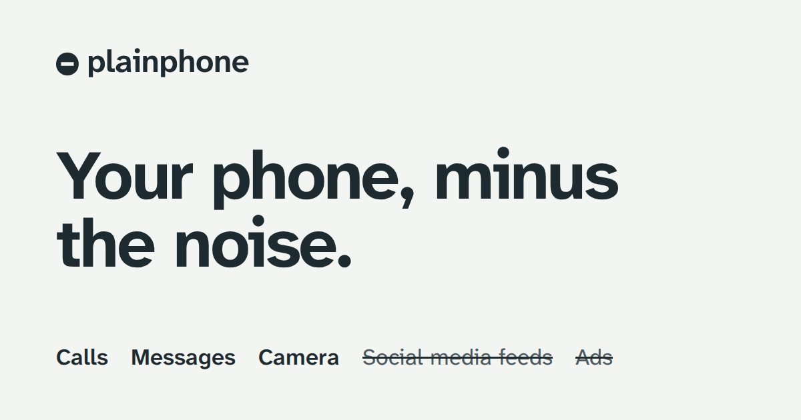

# Plainphone

[](https://github.com/plainphone/plainphone/actions/workflows/ci.yml)
[](LICENSE)

Plainphone turns an ordinary Android phone into a calm phone: calls, messages, maps, music and the apps you actually need, without social media, endless feeds, games and porn.

<p align="center">
  
</p>

It is meant for a parent setting up a child's first phone, and for adults who want to hold themselves to their own rules. The rules work the same way in both cases. What changes is who holds the key.

[plainphone.org](https://plainphone.org) · [Parent dashboard](https://app.plainphone.org) · [Setup guide](https://plainphone.org/setup/) · [Releases](https://github.com/plainphone/plainphone/releases)

> **Status: early, pre-release.** The releases are test builds signed with a test key, and not every part has been tested on a real phone. Only install Plainphone on a spare phone that you are ready to factory reset, and do not rely on it for a child's phone yet.

## Why

Plainphone is built on a short list of [design principles](docs/design-principles.md), each tied to research, regulation or official guidance. The [evidence review](docs/evidence.md) lists the sources per feature and says where the evidence is weak. In short:

- the child can see, on the phone, what the parent can see;
- monitoring is visible, never hidden;
- emergency calls and help stay reachable whatever the rules say;
- no streaks, rewards or engagement tricks;
- as little data as possible, kept as briefly as possible.

A filter reduces exposure. It does not make a phone safe, and Plainphone does not claim to.

## How it works

One Android app, two ways to install it. The phone follows the rules set in the parent dashboard (the [web app](web) or the [native app](parent-app)). Offline, the last rules keep applying, and an error never loosens anything.

### Strong mode: a new or reset phone

The app is set up by QR code on a factory-reset phone (Android 10 or newer, see [docs/android-versions.md](docs/android-versions.md)) and becomes **Device Owner**. It then:

- blocks app installs (Play Store and APK files), factory reset from Settings, safe mode, new users, guest mode, private space, app cloning, developer options and adb;
- forces private DNS (DNS-over-TLS) to a filtering resolver and stops the user from changing private DNS, VPN, network reset and user certificates;
- turns Chrome's own DNS-over-HTTPS and incognito mode off and forces SafeSearch;
- hides every app that is not on the allowlist: phone, messages, camera, clock, contacts, settings, keyboard and launcher (found per device, so Samsung and Xiaomi keep their own apps), plus Chrome, Maps, calculator, calendar and gallery;
- requires automatic date and time, blocks USB file transfer and SD cards, and blocks uninstalling Plainphone;
- optionally sets a Factory Reset Protection policy for chosen Google accounts.

A hidden maintenance screen protected by a parent PIN can lift the lock for a while, re-apply it, or release Device Owner completely, so a test phone never has to be thrown away. A parent can also release a phone from the dashboard (**Release the phone**): the phone switches Plainphone off by itself the next time it is online. The dashboard shows the release as pending until the phone confirms it has switched off.

Adding a Play account during an approved app install needs the parent PIN. Plainphone requests Google sign-in directly while Android keeps user account changes blocked. If sign-in fails, the parent can retry with account changes allowed briefly within the same [installation window](docs/app-catalog.md). The retry option expires when that window ends. Once tapped, it allows account changes for at most three minutes. The dashboard warns if Plainphone detects an unexpected account change. Reset protection and hardware system checks are described in [docs/policies.md](docs/policies.md).

[docs/policies.md](docs/policies.md) lists every policy, what Android does not let us block, and links to the Android documentation.

**Protection after a reset.** Link a parent’s Google account in the dashboard. Wait until the account is ready and the phone reports that it has saved the protection settings before resetting the phone. See [docs/policies.md](docs/policies.md#factory-reset-protection).

### Light mode: a phone already in use

The same APK, installed as a normal app, without a reset. A local VPN that only carries DNS provides the web filter, and an accessibility service keeps apps that are not allowed from opening. It is weaker than strong mode, and the dashboard says exactly how. The guard checks protected Settings windows when they open or regain focus. It verifies the active window before sending Back. It retries if Android rejects that action. On first launch, choose **Child**, **Parent**, or **Myself**. Parent opens the dashboard without
requesting permissions. Child and Myself confirm the phone and check the dashboard account
before Android asks for permissions. Light-mode setup can be undone without a PIN for ten
minutes after finishing permissions. Rebooting closes the window. Undo switches off protection
even offline. When the phone reconnects, it updates the dashboard and makes Plainphone available
for uninstallation. Undo notices are sent only to current household members. Device Owner setup
also waits for confirmation on the phone before applying Plainphone policies. See [docs/light-mode.md](docs/light-mode.md).

### In both modes

- **Approved contacts.** Plainphone becomes the default phone and SMS app. Calls and SMS to and from numbers that are not on the list are blocked; hidden callers are rejected. 112, 911, 114 and the phone's own emergency numbers always work, and after an emergency call anyone can call back for an hour. See [docs/contacts.md](docs/contacts.md).
- **Helplines.** Children can reach listed support services from Help. See [the helpline policy](docs/policies.md#help-lines).
- **A filter DNS per phone.** Each phone gets its own DNS-over-TLS address (`<id>.dns.plainphone.org`) on the Plainphone resolver in [`dns/`](dns). Both parent apps explain the filter's limits even when the DNS settings cannot load. How apps could still get around it: [docs/dns-bypass.md](docs/dns-bypass.md).
- **Rules from the server.** App list, approved contacts, school time, bedtime, [time limits](docs/time-limits.md) and [phone settings](docs/phone-settings.md). The phone syncs every 15 minutes, at boot, on network changes and every minute while the screen is on. The app inventory refreshes when installed apps, the phone locale, or enabled keyboard packages change. See [phone sync](docs/phone-sync.md) and the [Android wakeup inventory](docs/wakeups.md).
- **Location on request.** By default the phone shares its position when a parent presses Find or when a check-in reaches its reply deadline without an answer. The server waits briefly before showing a check-in position so a reply arriving at the same time can still win. The phone sends saved or cached positions before requesting new ones, then looks up new positions in order of server expiry. Older Android apps can answer both requests with one position. The map can show the last known position with its original time if a lookup fails. An older position leaves Find open for a newer one. Each lookup has a 30-second budget, and each request gets up to five precise attempts. Sharing every few minutes is an explicit, time-limited choice. Only the latest position is kept, and the child can see each request on the phone. See [docs/location.md](docs/location.md).
- **Status.** Battery, when the phone was last online, app version and whether the lock is intact. The web dashboard groups phone rules by what they control, when they apply, and what they change on the phone. If a lock step fails, the dashboard describes it in plain language and offers technical details. Both parent apps show a warning if app installation stayed open longer than planned during an update, even when the lock is intact. Both apps also show when the phone detects an unexpected account change, needs consent for a call role, or has removed parallel apps.
- **Self profile.** For adults using Plainphone on their own phone: changes that loosen the rules wait for a delay, or need approval from a person you trust.

## Get started

**As a parent:** sign in at [app.plainphone.org](https://app.plainphone.org), choose **Add phone** and follow the [illustrated setup guide](https://plainphone.org/setup/). [docs/dashboard-setup.md](docs/dashboard-setup.md) covers both modes in detail. The hosted service is a test version.

**Self-hosting:** the server and the parent web app ship as one Docker image with PostgreSQL. See [docs/self-hosting.md](docs/self-hosting.md), and [docs/self-hosting-dns.md](docs/self-hosting-dns.md) for the filter DNS.

**On a spare test phone:** [docs/setup-test-phone.md](docs/setup-test-phone.md) walks through it step by step, including how to get out again. [docs/bypass-checklist.md](docs/bypass-checklist.md) lists every bypass attempt to try, with the expected result.

## Privacy and security

- [docs/privacy.md](docs/privacy.md) says what is stored, for how long and why.
- [docs/encryption.md](docs/encryption.md) specifies end-to-end encryption between the phone and the parent's devices. It is a specification under development and **not implemented yet**. Today the hosted service stores readable data in its application database.
- **Plainphone has not had an external security audit.**
- A way around the lock is a security bug. Report it privately as described in [SECURITY.md](SECURITY.md).

## Repository

| Folder | What it is |
|---|---|
| [`android/`](android) | The phone app (Kotlin, Jetpack Compose) for strong and light mode |
| [`server/`](server) | The API (Hono, PostgreSQL). [docs/sync-api.md](docs/sync-api.md) is the phone's side of it |
| [`web/`](web) | The parent web app (PWA) at app.plainphone.org. See the [dashboard UX review](docs/ux-review.md) |
| [`parent-app/`](parent-app) | The native parent app for iOS and Android (Expo), see [docs/parent-app.md](docs/parent-app.md) |
| [`dns/`](dns) | The filter DNS: AdGuard Home and `ppdns`, its profiles and API. [docs/privacy.md](docs/privacy.md) says what it stores |
| [`site/`](site) | plainphone.org (static, no JavaScript) |
| [`packages/`](packages) | Shared encryption test vectors |
| [`scripts/`](scripts) | The provisioning QR script, a release APK smoke test and an end-to-end test of the phone sync |
| [`docs/`](docs) | Design, evidence, policies and how-tos |

## Build the Android app

Requirements: JDK 21 and the Android SDK (command-line tools are enough; Android Studio is not needed) with `platforms;android-37.0` and `build-tools;36.1.0`.

```sh
cd android
echo "sdk.dir=$ANDROID_HOME" > local.properties
./gradlew testDebugUnitTest lintDebug assembleDebug
```

The debug APK ends up in `android/app/build/outputs/apk/debug/`. The server, web app, parent app, DNS and site are covered in [CONTRIBUTING.md](CONTRIBUTING.md).

The Android location-budget tests use a simulated monotonic clock to exercise provider fallback and expiry without waiting for the phone's lookup deadline.

The APK includes English and Danish resources. The phone draws its pairing QR code with the vendored [Nayuki QR Code generator v1.8.0](https://github.com/nayuki/QR-Code-generator/tree/v1.8.0/java), with a local package name and locale-independent error formatting. Its MIT license is included in the APK and credited in [NOTICE](NOTICE).

See [CI and build](docs/ci-build.md) for workflow triggers, cache behavior and Docker build measurements.

### Signing

No keys are stored in this repository. A release build reads its signing settings from a properties file outside the repository:

```properties
storeFile=/path/outside/the/repo/plainphone.jks
storePassword=...
keyAlias=...
keyPassword=...
```

```sh
PLAINPHONE_SIGNING=/path/to/signing.properties ./gradlew assembleRelease
```

Without `PLAINPHONE_SIGNING`, the release build is signed with your local debug key. The pre-release APKs on GitHub are signed with a **test key** (certificate CN "Plainphone TEST key (not for production)"). Do not trust that key for anything except testing.

### Setup QR code

In the dashboard, **Add phone** starts with a new or reset phone (strong mode) or one
already in use (light mode). Strong mode uses Android's welcome screen and can include Wi-Fi in
the provisioning code. The browser hashes the maintenance PIN before adding it to the
code. Light mode keeps the phone's existing data. Chrome installs the app and opens the setup
link, then the phone asks who will use it and hashes the PIN locally. In both modes, check the
masked dashboard account on the phone before it redeems the one-time token. The server receives
neither the PIN nor its hash.

For self-hosting, tests and phones without an account there is a script with the same format:

```sh
scripts/provisioning-qr.py \
  --apk android/app/build/outputs/apk/release/app-release.apk \
  --apk-url https://example.org/plainphone.apk \
  --ask-pin --out dist/provisioning-qr
```

The script reads the signing certificate checksum from the APK (or takes `--checksum`), asks for or generates the maintenance PIN (6+ digits), hashes it and writes `dist/provisioning-qr.json` and `.png`. Without `--apk-url` it uses the stable download address. Run `scripts/provisioning-qr.py --help` for Wi-Fi, DNS host, extra apps, FRP accounts and `--enroll-token`. A QR code with a Wi-Fi password in it must not be published.

- `--server-url https://your.server` points the phone at a self-hosted server (default `https://app.plainphone.org`). Once paired, the server registers the phone's own DNS ClientID and the phone switches to it by itself, so `--dns-host` can stay at the default.
- `--dns-host '{id}.dns.plainphone.org'` gives the phone its own ClientID on the Plainphone resolver (`{id}` is replaced by `--dns-id`, or a new random ID). The ClientID must be registered on the DNS server first (`ppdns create child`, then pass the printed ID as `--dns-id`), otherwise the phone gets no DNS at all. The default is still `family.adguard-dns.com` until the resolver is live.
- `--contact 'Mum=+45 12 34 56 78'` (repeatable) and `--country-code 45` set the first approved contacts.

A phone configured with the script can show a pairing code, which the parent claims in the dashboard and the phone confirms after showing the account. The device token is sealed with a key in the Android Keystore. Pairing again later needs the maintenance PIN.

## Updating the phone app

In strong mode Plainphone checks daily on an unmetered connection or while charging and
installs a newer release signed with the same certificate when Android allows Plainphone
to run without battery optimization. **Update now** on the phone's
dashboard page uses a direct connection while the screen is on, and push and rules sync
deliver the request with the screen off. In light mode the
phone shows a quiet update notification for manual installation. See
[Android updates](docs/android-updates.md) for the first manual update, the foreground
watchdog, deadline recovery even when lease storage fails, release metadata, and the
real-phone release check.

## Roadmap

1. Proof of lock
2. Contacts and DNS: dialer and SMS role with an allowlist, own AdGuard Home with a DNS address per phone
3. Server and parent web app: accounts, pairing, rules, app list, location, school time
4. Light mode on a phone already in use; time limits and an app catalog ([docs/app-catalog.md](docs/app-catalog.md))
5. Native parent apps
6. Self-hosting, plainphone.org and the public launch

End-to-end encryption ([docs/encryption.md](docs/encryption.md)) is being specified alongside.

## Contributing

Issues and pull requests are welcome. Read [CONTRIBUTING.md](CONTRIBUTING.md) first: every user-facing change states its evidence. Questions and ideas go to [Discussions](https://github.com/plainphone/plainphone/discussions), and [how we handle your contribution](docs/maintaining.md) says what happens next. Please follow the [code of conduct](CODE_OF_CONDUCT.md).

## License

Apache License 2.0, see [LICENSE](LICENSE) and [NOTICE](NOTICE). The name and logo are covered by [TRADEMARK.md](TRADEMARK.md). Plainphone is maintained by [Mahoje](https://mahoje.dk) in Denmark.
