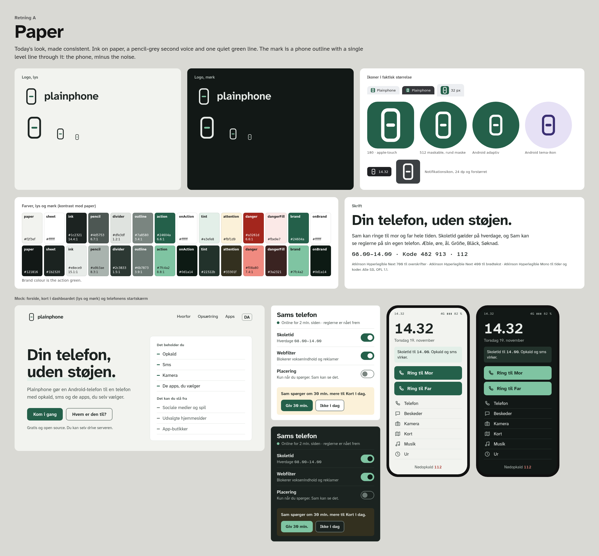
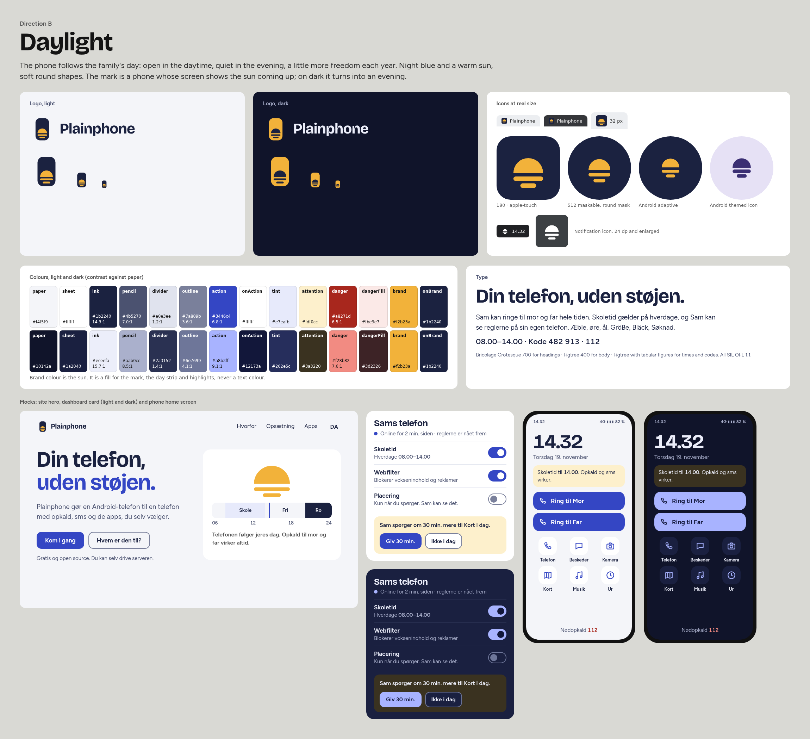
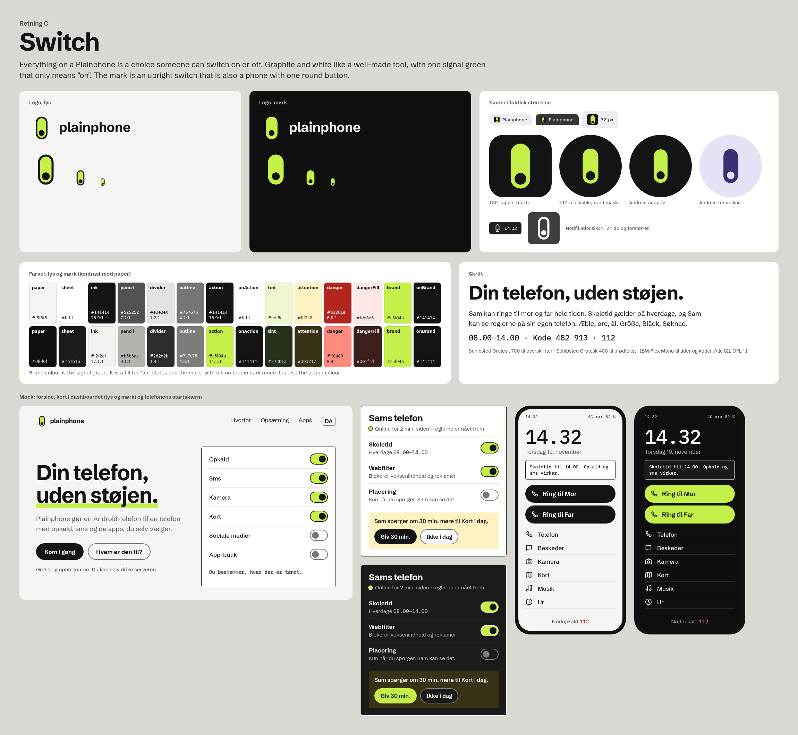

# Plainphone brand and design guide

One logo, one favicon and one look on every surface: the site, the web dashboard, the parent app, the phone and the mails.

**Status: direction C chosen (19 November 2026).** This guide proposed three visual directions (A, B, C), and C, Switch, was chosen. Every surface uses it: the site (plainphone.org), the web dashboard, the parent app, Android and the mails (see the [inventory](#asset-inventory)).

| | A · Paper | B · Daylight | C · Switch |
| --- | --- | --- | --- |
| Overview | [](directions/a/overview.png) | [](directions/b/overview.png) | [](directions/c/overview.png) |
| Idea | Today's paper, ink and quiet green, made consistent. Mark: a phone outline with one level line. | The phone follows the family's day. Night blue and a warm sun. Mark: a sun coming up over water inside a phone. | Everything is a choice you can switch on or off. Graphite, white and one signal green. Mark: an upright switch that is also a phone. |
| Strengths | Already in use on the site and dashboard, so rollout is cheap. Calm and readable. Tokens (#143) and Atkinson Hyperlegible Next carry over unchanged. | Warmest and most child-friendly. The day strip explains schedules and quiet nights in one picture. Clear dark-mode story. | Most distinctive and most legible at 16 px. Says the core product rule out loud ("everything can be switched off"). Minimal and modern. |
| Risks | Least memorable. The green tile looks like many productivity apps. Not much of a redesign. | Most colour to maintain. At small sizes the sun and lines can look like a burger. Blue and yellow carry Swedish-flag/IKEA associations in the Nordics. Bricolage Grotesque is a trend font in 2025–26. | Lime can feel like fintech or sportswear. Graphite can feel cold for young children. A switch could be read as "control", so copy must keep saying who decides and that the child can see it. The knob sits at the bottom (the phone's button), and on a vertical switch down can read as "off" while the fill says "on"; test this with parents before the rollout, or move the knob up. |
| Fit with the [design principles](../design-principles.md) | Neutral language (7) and honesty (10): nothing promises more than it does. | Quiet at night (9) and growing independence (6) are built into the picture. Risk of feeling playful where calm is better. | Visible rules (1, 2) and the toggle rule are the brand itself. The "on" colour is only used for state, never decoration, which keeps it neutral (7). |

**Recommendation: C, Switch.** Mads asked for a full redesign that is simple, minimalist and modern, and the product rule from 19/11-26 is that everything can be switched on and off. C is the only direction where the logo itself says that, and it gives the strongest favicon at 16 and 32 px. Its palette has the highest body-text contrast of the three (16.9:1 light, 17.1:1 dark); its danger pairs are a little tighter than A and B but still pass AA. The cost: the action colour changes from green to graphite in light mode, so every surface needs its tokens changed. That work is needed for any new direction anyway (see [inventory](#asset-inventory)). Keep the copy warm to offset the cool palette, and always show the switch with the person who decides ("Du bestemmer", "Sam kan se det"). If the redesign should be as low-risk as possible, choose A: it costs the least, but it is an evolution, not a new look.

## Brand core

### Purpose

Plainphone turns an Android phone into a calm phone: calls, messages and the apps a family chooses. For a child, the rules are visible and grow with them. For an adult who wants less, Myself mode adds friction with a way out. Open source, self-hostable and free.

### Personality

| Trait | Is | Is not |
| --- | --- | --- |
| Calm | Few elements, quiet colour, nothing blinks | Sleepy, grey, joyless |
| Honest | Says what a setting does and what it cannot do | Promising safety, well-being or "addiction cures" |
| Open | Shows the child what the parents see; source code in the open | Hidden monitoring, dark patterns, sales in the child's view |
| Kind | Short, friendly sentences and a next step on every blocked screen | Cute, childish, exclamation marks |
| Practical | Literal labels, real times, things that work offline | Clever wordplay, jargon, features for their own sake |

### Voice and tone

Say what happened, who can act and when. One action per sentence. Use "du" and the child's phone ("din telefon"). Name the parent surfaces as the site does: "forældrepanelet" (Danish), "parent dashboard" (English). No exclamation marks in the product, no streaks, no shame.

| Before | After |
| --- | --- |
| Danish: "Adgang nægtet!" | "Kort er lukket i skoletiden. Du kan bede om mere tid." |
| Danish: "Telefonen er nu fuldt beskyttet." | "Webfilteret blokerer voksenindhold og reklamer. Det fanger ikke alt." |
| Danish: "Overvåg dit barns placering i realtid" | "Se, hvor telefonen er, når du spørger. Sam kan se, at du har spurgt." |
| Danish: "Forkert PIN." | "PIN-koden passer ikke. Prøv igen." |
| English: "Take back control of your time!" | "Your phone, minus the noise." |
| English: "Your child exceeded their screen time limit." | "Sam has used today's 1 hour of games. More time tomorrow at 7.00." |
| English: "Unlock premium protection" | "Plainphone is free. You can run your own server." |

### Naming

- **Plainphone**, one word, capital P in running text in every language. The wordmark may be lowercase (A, C) or capitalised (B). Never "PlainPhone", "Plain Phone" or "PP".
- **Strong mode / stærk tilstand** (Device Owner) and **light mode / let tilstand**. Lowercase in running text. Do not call them "parental control" or "lockdown".
- **Myself** is the profile for adults who set limits for themselves. Danish: **Til mig selv**. Capitalise Myself in English; never translate it as "selvkontrol".
- The parent surfaces are the **parent dashboard / forældrepanelet** (web) and the **parent app / forældreappen** (Expo).
- Plainphone is a product name, not a verb.

## Asset inventory

Every place a logo, icon, favicon or brand colour lives today. Today there are **three different marks** and **four different palettes**.

| Surface | File | What it is today |
| --- | --- | --- |
| Site | `site/src/brand/` (copies of `directions/c/`), `favicon-32.png`, `apple-touch-icon.png` | Done: direction C mark, wordmark, favicon and apple-touch icon |
| Site | `site/src/og-{en,da,sv,nb,de}.png` (from `site/tools/make-images.mjs`) | Done: direction C share images with the hero switch panel |
| Site | `site/build.mjs` `theme-color` | Done: C paper, `#f5f5f3` / `#0f0f0f` |
| Site | `site/src/style.css`, `site/src/fonts/` | Done: C palette, Schibsted Grotesk and IBM Plex Mono (OFL) |
| Mail | `web/public/mail/lockup@2x.png`, `lockup-dark@2x.png` (from `web/scripts/make-icons.mjs`), served by each instance at `<PUBLIC_URL>/mail/` | Done: direction C lockup (outlined wordmark), 130 × 32 shown, 2× PNG. The site's old `site/src/mail/logo*.png` are no longer used by the server, but keep them: mails already sent load `https://plainphone.org/mail/logo@2x.png` |
| Mail | `server/src/lib/mail-templates.ts` | Done: C palette light and dark, ink card edge, pill button (signal green in dark, ink on the SOS mail), Schibsted Grotesk with system fallback |
| Web dashboard | `web/public/icon.svg`, `web/public/icons/{favicon-16,favicon-32,icon-192,icon-512,maskable-192,maskable-512,apple-touch-icon,badge-96}.png` (from `web/scripts/make-icons.mjs`) | Done: C favicon (16 px drawing below 24 px), app icon, maskable icon and a white push badge |
| Web dashboard | `web/public/manifest.webmanifest`, `web/index.html` | Done: `theme-color` and background are C paper, `#f5f5f3` / `#0f0f0f` |
| Web dashboard | `web/src/styles.css`, `web/src/fonts/`, `components/Mark.tsx` | Done: C tokens incl. `--brand`, Schibsted Grotesk and IBM Plex Mono (OFL), the C mark in the header |
| Parent app | `parent-app/assets/{icon,android-icon-foreground,android-icon-background,android-icon-monochrome,splash-icon,splash-icon-dark,notification-icon,favicon}.png` (from `parent-app/scripts/make-icons.mjs`) | Done: C app icon, adaptive and themed icon, splash in light and dark, white notification icon |
| Parent app | `parent-app/app.config.ts` | Done: splash `#f5f5f3` / `#0f0f0f`, adaptive background and notification colour `#141414`, fonts linked by `expo-font` |
| Parent app | `parent-app/src/lib/theme.ts`, `assets/fonts/`, `components/Mark.tsx` | Done: C tokens incl. `brand`, Schibsted Grotesk and IBM Plex Mono |
| Android | `res/mipmap-anydpi-v26/ic_launcher{,_round}.xml`, `res/drawable/ic_launcher_{foreground,background,monochrome}.xml`, `res/mipmap-{m,h,xh,xxh,xxxh}dpi/` (from `android/scripts/make-icons.mjs`) | Done: adaptive launcher icon with a themed-icon layer; also used by the messages launcher alias |
| Android | `res/drawable/ic_notification.xml` as `setSmallIcon` in `telephony/CallNotifications.kt`, `safety/RingService.kt`, `safety/Safety.kt`, `update/AndroidUpdateHost.kt`, `update/UpdateBatteryExemption.kt` | Done: white switch outline on transparent (checked in `BrandIconsScreenshotTest`) |
| Android | `ui/Tokens.kt`, `ui/Theme.kt`, `MaintenanceStyle.kt`, `res/font/`, `home/HomeColors.kt` | Done: C tokens, Schibsted Grotesk and IBM Plex Mono, ink call buttons. The grey (Graphite) launcher palette is C graphite and the default; sage and sand stay as softer choices |
| README | `README.md` | Done: badge in `141414`. The hero image is `site/src/og-en.png` (site redesign) |
| Store listing | `fastlane/play/` (phone app, Play edition), `parent-app/fastlane/metadata/android/` | Texts in five languages; no graphics yet (feature graphic 1024×500, icon 512). Plan: [docs/play/screenshots.md](../play/screenshots.md) |

The rollout (`feat/brand-rollout-switch`) replaced every non-site row above with direction C. Every generated file is rendered from the SVGs in [`directions/c/`](directions/c/), and the fonts come from `tools/product-fonts.py` at the same pinned google/fonts commit as `render.mjs`. Tokens: [`docs/design-tokens.md`](../design-tokens.md). Screenshots before and after: [`docs/screenshots/brand-rollout-switch/`](../screenshots/brand-rollout-switch/).

## Shared rules

These hold whichever direction is chosen.

### Logo

- **Clear space:** at least half the mark's height on every side of the mark and the lockup.
- **Minimum size:** mark 16 px (use the `favicon-16.svg` drawing below 24 px), lockup 96 px wide on screen, 20 mm in print.
- **Lockup:** mark left, wordmark right, wordmark height about half the mark's. Use `lockup.svg` on light and `lockup-dark.svg` on dark. The wordmark is outlined (`wordmark.svg`, `currentColor`), so it never depends on an installed font.
- **Do:** use the mark alone as the app icon and favicon; use the lockup in headers, mails and share images; keep one colour version for single-colour printing.
- **Don't:** stretch, rotate, outline, add shadows or gradients, put the mark on a photo, recolour it outside the palette, set the wordmark in another font, or combine it with a shield, lock, eye or map pin.

### Icons

24-unit grid, 2-unit rounded strokes, round joins, no fills except for state. One stable set for phone, message, contact, clock, shield, check, QR, map and camera. Use the platform's own Back, Close and Share. Icons that carry meaning get a text label; decorative icons are hidden from screen readers. Android notification icons are white silhouettes on transparent (`notification.svg`).

### Illustration and photos

- No photos or drawings of real children's faces, anywhere: site, store, mails, docs, tests. Use hands, phones, objects and places, or the product's own screens with fixture names (Sam Demo, Alex Demo).
- Show the product honestly: real screens, real copy, no fake notifications or invented numbers.
- No surveillance imagery: no radar, map pins following a child, eyes, padlocks or shields as the main motif.
- Illustrations are flat, use only palette colours and explain something (a schedule, a choice), never decorate.

### Motion

Use motion only to show that something changed: 120–180 ms opacity or colour, one property at a time. No looping animation, no confetti, no motion on blocked or calm screens. Respect `prefers-reduced-motion`, Android's animator setting and React Native `AccessibilityInfo`. Haptics are optional, off or system-controlled by default, and only on actual success.

### Accessibility (WCAG 2.2 AA)

- Text 4.5:1, large text and meaningful graphics and control outlines 3:1, checked in light and dark and in every state (focus, selected, pressed, warning, error). `render.mjs` fails if a palette pair drops below this.
- Colour never carries state alone: a switch shows position, a status shows a word.
- Hit areas: 44 × 44 CSS px on the web, 48 dp on Android, 44 pt on iOS. Visible focus ring in the action colour, at least 2 px.
- Text scales to 200 % and wraps; long Danish and German labels wrap instead of truncating.

### Token roles

Every direction fills the same roles as `docs/design-tokens.md` (added by PR #143, not yet on `main`; until then see the `feat/ux-common-tokens` branch), plus two brand roles:

| Role | Use |
| --- | --- |
| `paper` | Page and screen background |
| `sheet` | Cards, dialogs, grouped lists |
| `ink` | Text and icons |
| `pencil` | Secondary text, timestamps |
| `divider` | Hairlines between rows (decorative, no contrast requirement) |
| `outline` | Control boundaries, 3:1 |
| `action` | Links, primary buttons, focus ring |
| `onAction` | Text on a filled `action` |
| `tint` | Selected row, current rule |
| `attention` | Requests and notices that need a decision |
| `danger`, `dangerFill` | Destructive actions and errors |
| `brand` | The brand colour of the mark; A: the green, B: the sun, C: the signal green |
| `onBrand` | Text or knobs on a `brand` fill |

### Type

All fonts are under the SIL Open Font License 1.1 and cover æ, ø, å, ä, ö, ü, ß, digits, en dash, Danish and German quotes (checked by `tools/wordmarks.py`, result in [`glyph-check.json`](glyph-check.json)). Sizes from the [UX research](../research/ux-premium.md#shared-design-system-proposal): 14/20 metadata, 16/24 body and labels, 18/26 child-facing text, 24/30 screen titles, 32/38 large titles. Tabular digits for times and codes. The phone and the Expo app may keep the system font if bundling costs too much.

## Direction A · Paper


Today's look, made consistent. Ink on paper, a pencil-grey second voice and one quiet green line. The mark merges the site's circle-and-bar and the dashboard's phone into one: a phone outline with a single level line through it, the phone minus the noise. The wordmark stays exactly as today.

- **Type:** Atkinson Hyperlegible Next 700 for headings, 400 for body (Braille Institute, OFL); Atkinson Hyperlegible Mono for codes and times. Designed for low-vision readers, distinct `Il1` and `O0`.
- **Shape:** 12 px surfaces, 10 px controls, 1 px dividers, no shadows.
- **Files:** [`directions/a/`](directions/a/): `mark.svg`, `mark-dark.svg`, `wordmark.svg`, `lockup.svg`, `lockup-dark.svg`, `favicon-16.svg`, `favicon.svg` (32), `app-icon.svg` (180 and 512), `maskable.svg`, `adaptive-foreground.svg`, `adaptive-background.svg`, `adaptive-monochrome.svg`, `notification.svg`. PNG previews in [`preview/`](directions/a/preview/), mocks in [`mocks-light.png`](directions/a/preview/mocks-light.png) and [`mocks-dark.png`](directions/a/preview/mocks-dark.png).

<!-- palette:a -->
| Role | Light | Dark |
| --- | --- | --- |
| paper | `#f2f3ef` | `#121816` |
| sheet | `#ffffff` | `#1b2320` |
| ink | `#1c2321` | `#e8ece9` |
| pencil | `#4d5753` | `#a9b3ae` |
| divider | `#dfe3df` | `#2c3833` |
| outline | `#7a8580` | `#6b7873` |
| action | `#24604a` | `#7fc4a2` |
| onAction | `#ffffff` | `#0d1a14` |
| tint | `#e3efe8` | `#22322b` |
| attention | `#fbf1d9` | `#33301f` |
| danger | `#a3261d` | `#f08a80` |
| dangerFill | `#fbe9e7` | `#3a2321` |
| brand | `#24604a` | `#7fc4a2` |
| onBrand | `#ffffff` | `#0d1a14` |
<!-- /palette:a -->

Measured contrast:

<!-- contrast:a -->
| Pair | Roles | Light | Dark | Needs |
| --- | --- | --- | --- | --- |
| Body text | `ink` on `paper` | 14.36 | 15.07 | 4.5:1 |
| Text on a sheet | `ink` on `sheet` | 16.01 | 13.46 | 4.5:1 |
| Secondary text | `pencil` on `paper` | 6.72 | 8.34 | 4.5:1 |
| Secondary text on a sheet | `pencil` on `sheet` | 7.49 | 7.45 | 4.5:1 |
| Links and focus ring | `action` on `paper` | 6.62 | 8.84 | 4.5:1 |
| Links on a sheet | `action` on `sheet` | 7.38 | 7.89 | 4.5:1 |
| Text on a filled button | `onAction` on `action` | 7.38 | 8.78 | 4.5:1 |
| Control outline | `outline` on `sheet` | 3.82 | 3.49 | 3:1 |
| Control outline on paper | `outline` on `paper` | 3.43 | 3.90 | 3:1 |
| Text on a selected row | `ink` on `tint` | 13.55 | 11.29 | 4.5:1 |
| Action on a selected row | `action` on `tint` | 6.24 | 6.62 | 4.5:1 |
| Text on an attention fill | `ink` on `attention` | 14.25 | 11.12 | 4.5:1 |
| Danger text | `danger` on `sheet` | 7.36 | 6.62 | 4.5:1 |
| Danger text on danger fill | `danger` on `dangerFill` | 6.28 | 6.00 | 4.5:1 |
| White on the brand green (icons) | `onBrand` on `brand` | 7.38 | 8.78 | 4.5:1 |
<!-- /contrast:a -->

## Direction B · Daylight


The phone follows the family's day: open in the daytime, quiet in the evening, a little more freedom each year. Night blue and a warm sun, soft round shapes and a day strip that shows school time, free time and the quiet night in one picture. The mark is a phone whose screen shows the sun coming up over water; on dark the colours swap and it becomes an evening. The lines under the sun are never wider than the sun, so the mark does not read as a hat.

- **Type:** Bricolage Grotesque 700 (optical size 48) for headings (Ateliers Triay, OFL); Figtree 400/600 for body and tabular digits (Erik Kennedy, OFL).
- **Shape:** 22 px surfaces, 14–18 px controls, no borders, tinted icon tiles on the phone.
- **Colour rule:** the sun (`brand`) is a fill only, never text. Night blue (`onBrand`) goes on top of it.
- **Files:** [`directions/b/`](directions/b/), same set as A. Mocks in [`mocks-light.png`](directions/b/preview/mocks-light.png) and [`mocks-dark.png`](directions/b/preview/mocks-dark.png).

<!-- palette:b -->
| Role | Light | Dark |
| --- | --- | --- |
| paper | `#f4f5f9` | `#10142a` |
| sheet | `#ffffff` | `#1a2040` |
| ink | `#1b2240` | `#eceefa` |
| pencil | `#4b5270` | `#aab0cc` |
| divider | `#e0e3ee` | `#2a3152` |
| outline | `#7a809b` | `#6e7699` |
| action | `#3446c4` | `#a8b3ff` |
| onAction | `#ffffff` | `#12173a` |
| tint | `#e7eafb` | `#262e5c` |
| attention | `#fdf0cc` | `#3a3220` |
| danger | `#a8271d` | `#f28b82` |
| dangerFill | `#fbe9e7` | `#3d2326` |
| brand | `#f2b23a` | `#f2b23a` |
| onBrand | `#1b2240` | `#1b2240` |
<!-- /palette:b -->

Measured contrast:

<!-- contrast:b -->
| Pair | Roles | Light | Dark | Needs |
| --- | --- | --- | --- | --- |
| Body text | `ink` on `paper` | 14.28 | 15.73 | 4.5:1 |
| Text on a sheet | `ink` on `sheet` | 15.56 | 13.72 | 4.5:1 |
| Secondary text | `pencil` on `paper` | 7.03 | 8.47 | 4.5:1 |
| Secondary text on a sheet | `pencil` on `sheet` | 7.66 | 7.39 | 4.5:1 |
| Links and focus ring | `action` on `paper` | 6.84 | 9.14 | 4.5:1 |
| Links on a sheet | `action` on `sheet` | 7.45 | 7.97 | 4.5:1 |
| Text on a filled button | `onAction` on `action` | 7.45 | 8.73 | 4.5:1 |
| Control outline | `outline` on `sheet` | 3.90 | 3.56 | 3:1 |
| Control outline on paper | `outline` on `paper` | 3.58 | 4.08 | 3:1 |
| Text on a selected row | `ink` on `tint` | 13.01 | 11.17 | 4.5:1 |
| Action on a selected row | `action` on `tint` | 6.23 | 6.49 | 4.5:1 |
| Text on an attention fill | `ink` on `attention` | 13.72 | 10.97 | 4.5:1 |
| Danger text | `danger` on `sheet` | 7.06 | 6.64 | 4.5:1 |
| Danger text on danger fill | `danger` on `dangerFill` | 6.02 | 5.99 | 4.5:1 |
| Night ink on the sun (mark, highlights) | `onBrand` on `brand` | 8.30 | 8.30 | 4.5:1 |
| Sun on paper (decorative only) | `brand` on `paper` | 1.72 | 9.70 | none, not text |
<!-- /contrast:b -->

## Direction C · Switch


Everything on a Plainphone is a choice someone can switch on or off, and only 112 and the parents can't be switched off. Graphite and white like a well-made tool, with one signal green that only ever means "on". The mark is an upright switch that is also a phone with one round button. The site hero is the list of switches itself: calls, messages and camera on, social media and app store off.

- **Type:** Schibsted Grotesk 400/700 for headings and body (Schibsted Media, Norway, OFL); IBM Plex Mono 500 for times, codes and the phone clock (IBM, OFL).
- **Shape:** 6 px surfaces with a 1.5 px ink border, pill-shaped buttons and switches, no shadows.
- **Colour rule:** signal green (`brand`) is a fill for "on" states and the mark, always with ink on it and an ink edge on light backgrounds (it is 1.2:1 against paper). It is never used for decoration, highlights, warnings or call buttons: call buttons on the phone are ink with paper text in both modes. In dark mode it is also the action colour for links, the focus ring and primary buttons.
- **Files:** [`directions/c/`](directions/c/), same set as A. Mocks in [`mocks-light.png`](directions/c/preview/mocks-light.png) and [`mocks-dark.png`](directions/c/preview/mocks-dark.png).

<!-- palette:c -->
| Role | Light | Dark |
| --- | --- | --- |
| paper | `#f5f5f3` | `#0f0f0f` |
| sheet | `#ffffff` | `#1b1b1b` |
| ink | `#141414` | `#f2f2ef` |
| pencil | `#525252` | `#b3b3ae` |
| divider | `#e3e3e0` | `#2d2d2b` |
| outline | `#767676` | `#7c7c78` |
| action | `#141414` | `#c5f04a` |
| onAction | `#ffffff` | `#141414` |
| tint | `#eef8cf` | `#27301a` |
| attention | `#fff2c2` | `#393217` |
| danger | `#b3261e` | `#ff8a80` |
| dangerFill | `#fde8e6` | `#3e1f1d` |
| brand | `#c5f04a` | `#c5f04a` |
| onBrand | `#141414` | `#141414` |
<!-- /palette:c -->

Measured contrast:

<!-- contrast:c -->
| Pair | Roles | Light | Dark | Needs |
| --- | --- | --- | --- | --- |
| Body text | `ink` on `paper` | 16.88 | 17.09 | 4.5:1 |
| Text on a sheet | `ink` on `sheet` | 18.42 | 15.36 | 4.5:1 |
| Secondary text | `pencil` on `paper` | 7.16 | 9.11 | 4.5:1 |
| Secondary text on a sheet | `pencil` on `sheet` | 7.81 | 8.18 | 4.5:1 |
| Links and focus ring | `action` on `paper` | 16.88 | 14.55 | 4.5:1 |
| Links on a sheet | `action` on `sheet` | 18.42 | 13.07 | 4.5:1 |
| Text on a filled button | `onAction` on `action` | 18.42 | 13.98 | 4.5:1 |
| Control outline | `outline` on `sheet` | 4.54 | 4.11 | 3:1 |
| Control outline on paper | `outline` on `paper` | 4.16 | 4.57 | 3:1 |
| Text on a selected row | `ink` on `tint` | 16.64 | 12.29 | 4.5:1 |
| Action on a selected row | `action` on `tint` | 16.64 | 10.46 | 4.5:1 |
| Text on an attention fill | `ink` on `attention` | 16.43 | 11.40 | 4.5:1 |
| Danger text | `danger` on `sheet` | 6.54 | 7.55 | 4.5:1 |
| Danger text on danger fill | `danger` on `dangerFill` | 5.56 | 6.48 | 4.5:1 |
| Ink on signal green ("on" fill) | `onBrand` on `brand` | 13.98 | 13.98 | 4.5:1 |
| Signal green on paper (fill only, with an ink edge) | `brand` on `paper` | 1.21 | 14.55 | none, not text |
<!-- /contrast:c -->

## Regenerating the previews

The marks, icons and favicons (`mark*.svg`, `favicon*.svg`, `app-icon.svg`, `maskable.svg`, `adaptive-*.svg`, `notification.svg`) are written by hand. Everything else is generated and committed, so do not edit it by hand: `wordmark.svg` and `glyph-check.json` come from `tools/wordmarks.py`, and `lockup.svg`, `lockup-dark.svg`, the PNGs and the contrast tables come from `render.mjs`. The script fetches the fonts from `google/fonts` at a pinned commit into `docs/brand/.cache/` (git-ignored).

```sh
node docs/brand/render.mjs --fonts        # fetch the fonts
python3 docs/brand/tools/wordmarks.py     # outline the wordmarks, check glyphs (pip install fonttools)
node docs/brand/render.mjs --check        # contrast only: update the tables above, fail below AA
NODE_PATH=<dir with playwright> node docs/brand/render.mjs   # all of the above plus lockups and PNGs
```
